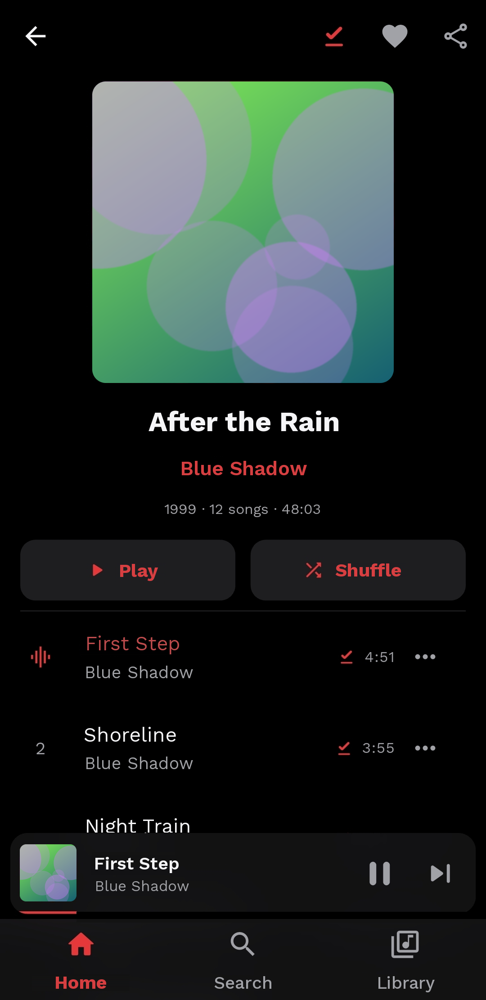
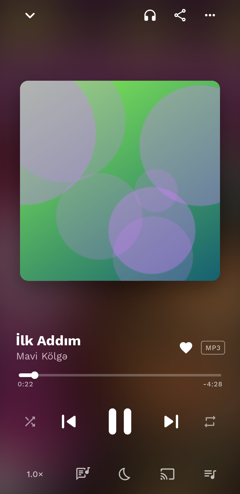
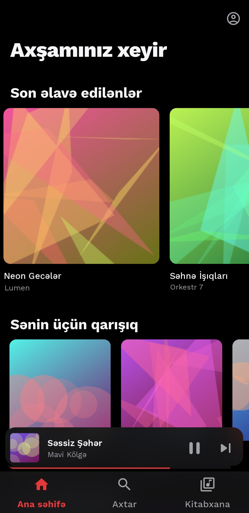
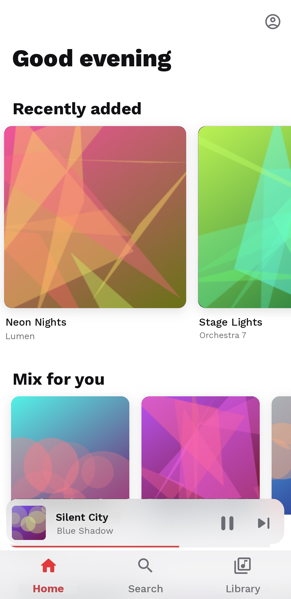

<div align="center">


# Melody

**A free, open-source music player for your own Jellyfin or Navidrome / Subsonic server.**
No ads, no tracking, no account with us: your music, your server, your phone.

[](https://github.com/engineer948/Melody-app/releases/latest)
[](https://github.com/engineer948/Melody-app/releases)
[](https://github.com/engineer948/Melody-app/stargazers)
[](https://github.com/engineer948/Melody-app/actions/workflows/ci.yml)
[](LICENSE)


[**⬇ Download the latest APK**](https://github.com/engineer948/Melody-app/releases/latest) · [Website](https://engineer948.github.io/Melody-app/)






</div>

## Features

- 🎵 **Your Jellyfin or Navidrome / Subsonic library**: albums, artists, genres, playlists (smart
  playlists, M3U import/export), search, favourites
- 📴 **Offline downloads** and Wi-Fi / mobile streaming quality
- 🎤 **Synced lyrics** that line up by themselves with each song
- 🎛️ Equalizer, volume normalisation, crossfade, sleep timer, Auto DJ
- 🚗 Android Auto, home screen widget, playback on DLNA devices
- 📊 Listening statistics and a Year in Review, kept on your phone
- 📍 "Soundtrack of your life" (opt-in): the places and photos of the days
  you listened, never leaving the phone
- 📤 Share songs as story pictures, 5–60 s clips or story videos
- 🎧 Listen together with other users of your server
- 🔒 Built-in Tailscale: friends reach your server with an invite code,
  without the Tailscale app ([docs/TAILSCALE.md](docs/TAILSCALE.md))

Updates appear in the app (GitHub builds). F-Droid: see
[docs/FDROID.md](docs/FDROID.md). Privacy and sharing terms:
[docs/LEGAL.md](docs/LEGAL.md).

**Copyright.** Melody plays and shares music from the user's own server.
Users alone are responsible for what they share (story images, song
clips) and must respect copyright; the app asks for this once before the
first song clip is shared. The app and its developers take no
responsibility for content shared by users.

## Contributing

Issues and pull requests are welcome. If you like the app, a ⭐ helps
others find it.

# For developers

## Running

Requires Flutter 3.47.9 (stable).

```bash
flutter pub get
```

```bash
flutter run
```

Checks:

```bash
flutter analyze
```

```bash
flutter test
```

Regenerate the generated code whenever you add or change a provider
(`@riverpod`), model (`@freezed`), DTO (`@JsonSerializable`) or database
table:

```bash
dart run build_runner build
```

Translation files (`lib/l10n/app_*.arb`) are compiled automatically by
`flutter pub get`.

## Sources and feature flag

Jellyfin and Subsonic (Navidrome, Airsonic, Gonic) are offered in the UI.
The other sources are turned on at build time:

```bash
flutter run --dart-define=ENABLED_SOURCES=jellyfin,subsonic,local
```

Valid values: `jellyfin`, `emby`, `subsonic`, `local`, `radio`
(see `lib/core/config/feature_flags.dart`). When more than one source is
enabled, the sign-in screen shows a source picker. In debug builds,
Settings → "Source test" also tries the hidden sources against an address.

| Source | Status |
|---|---|
| Jellyfin | complete |
| Emby | Built on the Jellyfin code; no Quick Connect and no server lyrics |
| Subsonic / OpenSubsonic (Navidrome, Airsonic, Gonic) | token + salt sign-in (password not stored), playlists, favorites, lyrics, scrobbling |
| Files on the device | Android MediaStore; permission is only requested when the source is added. No covers, ReplayGain or `.lrc` lyrics yet |
| Internet radio | Radio Browser; lists by genre, search, favorites, manual address (in code). No ICY "now playing" or country / language filters yet |

## Folder layout

```
lib/
  core/       config, device, errors (Result/Failure), logging, network (dio),
              router, settings, theme, utils, widgets
  domain/     models (Track, Album, Artist, ...), repositories (MusicSource,
              ServerConnector interfaces), stats (listening statistics),
              recommendation (recommendation scoring)
  data/       sources/jellyfin (API, DTOs, mapper, discovery), db (drift),
              repositories (cache, account store, LibraryRepository),
              downloads (download store and transport), history (listening
              history), dlna (SSDP discovery, AVTransport), tailnet
              (invite codes, Tailscale bridge, sign-in routing)
  player/     queue (PlayQueue), player controller, audio engines
              (just_audio, DLNA), notification / lock screen (audio_service),
              Android Auto tree, Auto DJ, history recording, widget
  features/   auth, home, library, album, artist, genre, playlist, search,
              player, share, social, tailnet, downloads, stats, settings, shell
  l10n/       ARB files (tr, en, az)
```

`native/tailscale/` is the Go side of the built-in Tailscale node
(`tool/build_tailscale.sh` turns it into `android/app/libs/tsbridge.aar`;
without it the feature is simply left out).

The UI (and the player) only know the `MusicSource` interface; everything
Jellyfin-specific lives under `lib/data/sources/jellyfin/`.

## Language

All documentation, code comments, commit messages, changelogs and GitHub
release notes are written in **English**. The app itself is translated
into English, Turkish and Azerbaijani (`lib/l10n/`, `fastlane/metadata/`).
See [CLAUDE.md](CLAUDE.md) for the full contributor notes.
